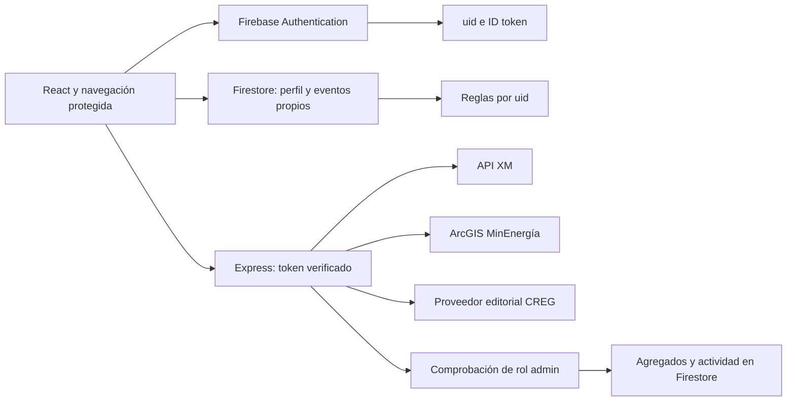

# Arquitectura e inventario

## Proyecto encontrado

La carpeta inicial contenía únicamente Backend: Bun, TypeScript, Express 5, Firebase Admin, CORS y Helmet, con separación de configuración, rutas, controladores y servicios. También estaban instalados un SDK externo de autenticación, jsonwebtoken y socket-io. No había frontend.

El login anterior consultaba un correo con Firebase Admin, pero no verificaba la contraseña. No establecía una sesión autenticada. Se corrigió mediante el SDK web de Firebase Authentication y validación de sus ID tokens en el backend.

Se conservó Bun/TypeScript/Express y Firebase Admin. El archivo Prisma existente se preservó, pero no hay un esquema Prisma activo en disco ni una dependencia Prisma utilizada: quedó fuera del alcance de compilación de esta plataforma. No se alteró la base SQL ni el .env original del backend.

## Ampliación de septiembre de 2026

Se añadieron roles, encuesta de preferencias y administración sobre las mismas colecciones. [ADMINISTRACION_Y_PREFERENCIAS.md](ADMINISTRACION_Y_PREFERENCIAS.md) detalla los campos, rutas, permisos y el procedimiento de asignación de administradores.

## Estructura final

```text
Frontend/src/
  config/         Firebase web; producción real y emuladores opcionales explícitos
  context/        estado de autenticación, perfil, rol y recuperación de sesión
  services/       autenticación auxiliar, perfil, eventos y API interna
  hooks/          ciclo de carga/error/cancelación
  components/     layout, tarjetas, gráficos, diálogos e iconografía
  pages/          acceso, inicio, comunidades, normativa, datos, perfil, privacidad
Backend/src/
  config/         Firebase Admin y orígenes permitidos
  middleware/     ID token Firebase, rol administrativo y límite de consultas
  routes/         auth, energía, métricas de compatibilidad y administración
  controllers/    controlador de sesión
  services/
    admin/        resumen, cuentas y actividad con acceso administrativo
    external/     HTTP validado, timeout y caché
    minenergia/   ArcGIS y recursos institucionales
    xm/           consultas y transformación de series
    creg/         interfaz de proveedor y catálogo editorial
    user-metrics.service.ts
shared/           interfaces y validación compartidas
tests/            navegador y reglas de seguridad
docs/             configuración, fuentes, arquitectura y verificación
```



## Modelo de datos Firestore

| Ruta | Datos | Escritura |
|---|---|---|
| profiles/{uid} | userId, name, interests, preferences, role, onboardingCompleted, createdAt, updatedAt | Propietario; role solo desde entorno administrativo de confianza |
| profiles/{uid}/interactions/{eventId} | userId, eventType, timestamp, contentId, source, metadata | Creación por su propietario; sin edición ni borrado desde el cliente |
| userMetrics/{uid} | userId, totalInteractions, contentViews, logins, calculatedAt, updatedAt | Solo backend autenticado; lectura del propietario |

`timestamp`, `createdAt` y `updatedAt` usan marcas del servidor. El campo de identidad siempre se deriva del usuario Firebase, nunca de un uid enviado libremente desde el formulario.

La subcolección de eventos evita necesitar un índice compuesto para el historial. La cuenta de servicio pudo publicar reglas, pero no administrar índices compuestos; la estructura final usa el índice automático de timestamp y no depende de ese permiso.

Las estadísticas se consultan exclusivamente en Administración; el backend reutiliza conteos e historiales durante un minuto. Son un resumen básico de eventos declarados por el cliente, no una clasificación ni una prueba antifraude. Una transacción comprueba que el perfil sigue existiendo antes de persistir los contadores.

El futuro motor puede consultar las subcolecciones o emplear consultas de grupo desde un backend autorizado. Necesitará sus propias reglas de negocio, tareas de procesamiento, índices de grupo y políticas de conservación. Los usuarios normales no reciben permisos para leer historiales ni métricas. Los administradores pueden consultarlos; las escrituras de eventos siguen siendo exclusivamente del usuario que los genera.

## Eventos implementados

| Evento | Momento |
|---|---|
| REGISTER | Creación de la cuenta Firebase |
| LOGIN | Inicio explícito de sesión |
| LOGOUT | Antes de cerrar la sesión |
| VIEW_DASHBOARD | Entrada al inicio |
| VIEW_ARTICLE | Apertura del detalle de un contenido |
| VIEW_REGULATION | Apertura del detalle de una resolución |
| VIEW_METRIC | Consulta o selección de indicador |
| CLICK_EXTERNAL_SOURCE | Apertura de un enlace oficial |
| VIEW_ENERGY_COMMUNITY | Expansión del detalle de una comunidad |
| UPDATE_PROFILE | Guardado del perfil |
| COMPLETE_ONBOARDING | Guardado confirmado de la encuesta inicial |
| SELECT_PREFERENCES | Modificación de los temas y formatos desde Mi perfil |

Metadata admite exclusivamente ruta interna sin querystring y sección. No se guardan correos, contraseñas, ID tokens, IP, ubicación del usuario ni identificadores del dispositivo.

Las escrituras de eventos no bloquean indefinidamente la navegación; se muestra su estado de sincronización. Sin conexión o con cierre prematuro del navegador puede haber eventos que no lleguen al servidor. La recuperación de sesión no se registra como un nuevo LOGIN.

## Seguridad y API propia

- Firebase administra todas las credenciales y valida la contraseña.
- El navegador usa persistencia local de Firebase y observa cambios de autenticación.
- Las rutas privadas esperan sesión y perfil; exigen encuesta completa. `/admin` y sus APIs comprueban además el rol.
- Los perfiles nuevos se crean como user; Firestore impide elevar o eliminar el rol desde el cliente.
- Backend: Bearer ID token validado con `verifyIdToken(token, true)`.
- Firestore: uid propio, campos permitidos, tipos, tamaños y marcas de tiempo del servidor.
- Eventos inmutables; agregados internos de escritura exclusiva del backend.
- Helmet, CORS acotado, JSON limitado a 8 KB y 90 consultas/minuto por uid.
- APIs externas fijas en dominios oficiales HTTPS; sin URL arbitraria desde el usuario.
- Las rutas anteriores POST /api/auth/register, /login y /logout responden 410 para impedir el uso del flujo inseguro previo.

Rutas internas adicionales:
- GET /api/health: estado público del servicio.
- GET /api/auth/me: identidad verificada.
- GET /api/profile/metrics: compatibilidad, ahora solo admin; estadísticas del uid del token.
- GET /api/admin/summary: resumen general administrativo.
- GET /api/admin/users?offset=0: lista de cuentas, en páginas de 20.
- GET /api/admin/users/:uid: detalle de cuenta con preferencias y hasta 20 eventos.

## Dependencias

Conservadas en ejecución: Express, Bun, TypeScript, Firebase Admin, CORS y Helmet.

Nuevas en frontend: React 19.2, React DOM, React Router 7.18, Firebase web 12.18 y Lucide React. Herramientas: Vite 7.3, plugin React y tipos TypeScript.

Nuevas herramientas de pruebas: Playwright 1.63, Firebase CLI 15.29 y @firebase/rules-unit-testing 5.0. Google Auth Library 10 se declaró directamente para scripts administrativos; ya era dependencia transitiva.

Se retiró `energy-community-auth-sdk` de package.json y bun.lock del backend para mantener la independencia. jsonwebtoken y socket-io existentes se conservaron, aunque no se utilizan en esta versión.

Las versiones completas reproducibles están en los tres archivos bun.lock. La instalación se realizó con Bun y no habilitó indiscriminadamente scripts postinstall bloqueados.

## Archivos originales modificados

- Backend/package.json y Backend/bun.lock.
- Backend/tsconfig.json.
- Backend/index.ts y Backend/src/app.ts.
- Backend/src/config/auth.config.ts y firebase.config.ts.
- Backend/src/services/auth.service.ts.
- Backend/src/controllers/auth.controller.ts.
- Backend/src/routes/auth.routes.ts.
- Backend/README.md: referencia a la documentación nueva, conservando su contenido anterior.

No se modificaron el .env original del backend, la cuenta de servicio ni prisma.config.ts. La aplicación web y sus archivos son nuevos.

## Archivos creados

El inventario completo se incluye en [ARCHIVOS.md](ARCHIVOS.md). Incluye Frontend, servicios oficiales nuevos, middleware, pruebas, configuración Firebase, scripts y documentación. Frontend/.env contiene la configuración pública real generada; está excluido del control de versiones y sus valores no se reproducen en la documentación.
