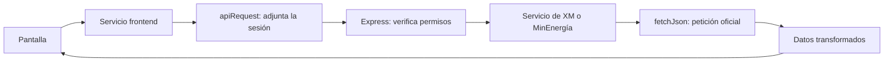

# Funciones principales explicadas con palabras simples

Guía actualizada para la versión con encuesta y administración. Los comentarios junto a las funciones explican su propósito; también aparecen al pasar el cursor en Visual Studio Code.

## Palabras del proyecto

| Palabra | Qué significa aquí |
|---|---|
| Frontend | Las pantallas que se ejecutan en el navegador. |
| Backend | El servidor que comprueba permisos y consulta fuentes oficiales. |
| uid | Identificador único de una cuenta en Firebase. |
| ID token | Comprobante de sesión emitido por Firebase. No es la contraseña ni el uid. |
| Servicio | Funciones agrupadas para realizar un trabajo, como consultar XM. |
| Caché | Resultados temporales que evitan repetir consultas constantemente. |
| Onboarding | La encuesta inicial para conocer los intereses de la persona. |

## Autenticación y acceso

Archivo: [AuthContext.tsx](../Frontend/src/context/AuthContext.tsx).

| Función | Qué hace |
|---|---|
| `AuthProvider` | Comparte usuario y perfil; recupera la sesión y escucha los cambios de Firestore, incluido el rol. |
| `register` | Valida los datos y pide a Firebase crear la cuenta. Prepara su perfil con el uid y registra REGISTER. |
| `login` | Pide a Firebase verificar correo y contraseña, conserva la sesión y registra LOGIN. |
| `logout` | Intenta guardar LOGOUT antes de cerrar la sesión. |
| `resetPassword` | Pide a Firebase enviar las instrucciones de recuperación. |

[SessionRoute](../Frontend/src/components/AccessRoutes.tsx) espera la sesión y el perfil. [ProtectedRoute](../Frontend/src/components/Layout.tsx) comprueba que la encuesta esté completa. [AdminRoute](../Frontend/src/components/AccessRoutes.tsx) permite la pantalla administrativa solo al rol admin.

El servidor también verifica el acceso:

- [requireAuth](../Backend/src/middleware/auth.middleware.ts) recibe el ID token y comprueba la sesión con [verifySession](../Backend/src/services/auth.service.ts).
- [requireAdmin](../Backend/src/middleware/admin.middleware.ts) lee el perfil del uid autenticado y comprueba que su rol sea admin. No acepta un rol enviado por el formulario.
- Las [reglas de Firestore](../firestore.rules) impiden que un usuario se convierta a sí mismo en administrador.

## Perfil y encuesta

Archivo: [profileService.ts](../Frontend/src/services/profileService.ts).

| Función | Qué hace |
|---|---|
| `ensure` | Crea el perfil si falta o completa los campos nuevos. Conserva datos, intereses y roles existentes. |
| `subscribe` | Escucha el perfil. Una escritura todavía pendiente no confirma una encuesta ni concede un rol. |
| `save` | Guarda el nombre y la preferencia visual de indicadores compactos. |
| `savePreferences` | Comprueba los temas y formatos y guarda las elecciones junto con onboardingCompleted en una sola escritura. |

[OnboardingPage](../Frontend/src/pages/OnboardingPage.tsx) presenta la encuesta y registra COMPLETE_ONBOARDING al confirmar su guardado. [ProfilePage](../Frontend/src/pages/ProfilePage.tsx) permite editar esas elecciones y registra SELECT_PREFERENCES; ya no consulta el historial de seguimiento.

[validatePreferences](../shared/preferences.ts) exige al menos un tema conocido y evita opciones inválidas o repetidas. `profileTopics` recupera los intereses antiguos como sugerencias.

## Interacciones y administración

[interactionService.track](../Frontend/src/services/interactionService.ts) sigue escribiendo en `profiles/{uid}/interactions`. Obtiene el uid de Firebase y guarda tipo, fecha del servidor, contenido, fuente y metadatos limitados.

Espera hasta 1,8 segundos para confirmar el guardado. Si no lo confirma, la escritura puede terminar después; cerrar el navegador antes de sincronizar puede impedir su entrega.

[calculateUserMetrics](../Backend/src/services/user-metrics.service.ts) cuenta todas las interacciones, consultas de contenido e inicios de sesión de un uid. Conserva el resumen en `userMetrics/{uid}` si su perfil existe. Sus rutas ahora requieren administración.

Archivo: [admin.service.ts](../Backend/src/services/admin/admin.service.ts).

| Función | Qué hace |
|---|---|
| `getAdminOverview` | Construye el resumen general: cuentas, contadores, actividad reciente y frecuencias de tipos. |
| `getAdminUsers` | Entrega hasta 20 cuentas por página, con preferencias y número de interacciones. |
| `getAdminUser` | Entrega la información de una cuenta, sus contadores y hasta 20 eventos. |
| `accounts` | Consulta Authentication y conserva solo los campos necesarios. No devuelve hashes de contraseñas ni tokens. |
| `activity` | Combina conteos de todo el historial con la lectura de los últimos 20 eventos. |
| `memo` | Reutiliza resultados durante un minuto. El permiso administrativo se comprueba en cada petición. |
| `mapLimited` | Procesa hasta cuatro cuentas al mismo tiempo para controlar el número de consultas simultáneas. |

Los contadores incluyen todo el historial de las cuentas y perfiles existentes. Las frecuencias de tipos se calculan sobre una muestra de hasta 20 eventos por perfil y se identifican como muestra.

## Fuentes oficiales

| Archivo | Función | Qué hace |
|---|---|---|
| [XM](../Backend/src/services/xm/xm.service.ts) | `getXmMetrics` | Envía POST a `https://servapibi.xm.com.co/hourly` para generación, demanda y precio. |
| XM | `xmWindow` | Selecciona los 14 días anteriores a hoy, con fecha de Colombia. |
| XM | `parseXm` | Comprueba 24 horas completas, suma energía y convierte a GWh o promedia los precios en COP/kWh. |
| [MinEnergía](../Backend/src/services/minenergia/minenergia.service.ts) | `getCommunities` | Consulta el ArcGIS oficial: primero identificadores y después hasta 24 registros. |
| MinEnergía | `communityWhere` | Prepara la búsqueda por nombre, departamento o municipio. |
| MinEnergía | `parseCommunities` | Convierte los campos públicos a nuestro formato y proporciona el enlace institucional comprensible. |
| [Artículos del Ministerio](../Backend/src/services/minenergia/articles.ts) | `getMinistryArticles` | Devuelve recursos oficiales seleccionados manualmente. No consulta una API. |
| [CREG](../Backend/src/services/creg/creg.service.ts) | `list` | Devuelve el catálogo manual de resoluciones y sus enlaces originales. No hace scraping. |

[CommunityDialog](../Frontend/src/components/CommunityDialog.tsx) muestra el detalle dentro de la plataforma. “Consultar fuente oficial” lleva al portal web del Ministerio, no al endpoint JSON.

## Cómo llega una consulta a la API

[fetchJson, cached y officialBase](../Backend/src/services/external/http.ts) controlan la petición externa, su espera máxima, la reutilización temporal y el dominio oficial.

[apiRequest](../Frontend/src/services/api.ts) adjunta el ID token y traduce errores. [useResource](../Frontend/src/hooks/useResource.ts) permite mostrar carga, resultado, error y un botón de reintento.

[deadline](../Frontend/src/services/errors.ts) deja de esperar una operación al vencer su plazo, pero no cancela una escritura de Firestore que ya se inició.

Para exponerlo, comienza por registro y uid, sigue con la encuesta, explica una consulta a XM y termina con `track` y la separación administrativa. El procedimiento para configurar administradores está en [ADMINISTRACION_Y_PREFERENCIAS.md](ADMINISTRACION_Y_PREFERENCIAS.md).
